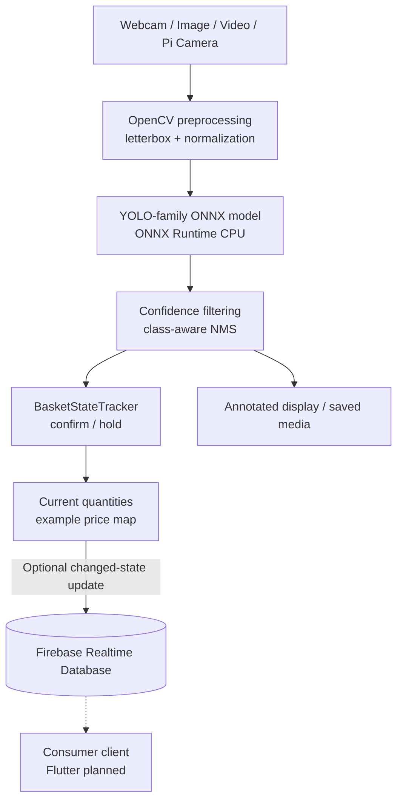

<div align="center">

# Smart Basket

### Edge AI · Smart Retail · Connected Shopping

**An intelligent shopping-basket prototype that transforms grocery-object detections into an itemized basket snapshot.**

<p>


</p>

**[Tech Stack](#technology-stack) · [Architecture](#system-architecture) · [Inference](#inference-pipeline) · [Get Started](#getting-started) · [Roadmap](#roadmap)**

</div>

---

## Technology Stack

<table>
<tr>
<td width="33%" valign="top"><h3>Computer Vision</h3><p>


</p><sub>Detection, image preprocessing, coordinates and bounding boxes.</sub></td>
<td width="33%" valign="top"><h3>Edge Inference</h3><p>


</p><sub>CPU inference with FP32 and quantized model artifacts.</sub></td>
<td width="33%" valign="top"><h3>Hardware</h3><p>


</p><sub>Dedicated Pi camera integration alongside laptop webcam support.</sub></td>
</tr>
<tr>
<td width="33%" valign="top"><h3>Cloud Synchronization</h3><p>


</p><sub>Change-only basket snapshots and connection status.</sub></td>
<td width="33%" valign="top"><h3>Training &amp; Research</h3><p>


</p><sub>Training notebook, annotated data and export workflow.</sub></td>
<td width="33%" valign="top"><h3>Client Integration</h3><p>


</p><sub>App-ready basket state; Flutter app source is not published here.</sub></td>
</tr>
</table>

## Project Highlights

<table>
<tr>
<td width="25%" valign="top"><strong>Visual product detection</strong><br/><sub>Identify the supported grocery categories from a camera feed.</sub></td>
<td width="25%" valign="top"><strong>Stable item counts</strong><br/><sub>Confirm and hold windows smooth short detection gaps.</sub></td>
<td width="25%" valign="top"><strong>Local edge processing</strong><br/><sub>Use ONNX Runtime on the host CPU.</sub></td>
<td width="25%" valign="top"><strong>Live basket data</strong><br/><sub>Publish changed quantities and example totals to Firebase.</sub></td>
</tr>
</table>

> [!IMPORTANT]
> **Published scope:** This repository currently contains the Python AI module, ONNX models and training notebook. It does **not** contain a Flutter application, a checkout system, production-grade product pricing or independently validated accuracy / Raspberry Pi benchmarks.

## Project Overview

Smart Basket explores a vision-based workflow for recognizing **visible** grocery products. It combines camera-based inference with a lightweight state tracker that builds a basket snapshot, estimates quantities and can update Firebase Realtime Database for a downstream application.

The focus is the **connection between model predictions and a usable basket state**. Unlike a transactional checkout, it cannot guarantee whether a particular item remains physically in a basket when it is out of camera view.

## System Architecture



| Layer | What it does |
| --- | --- |
| Image acquisition | OpenCV video/image/webcam input or Picamera2 capture |
| Inference | ONNX Runtime CPUExecutionProvider; configurable threading |
| Postprocessing | Supported YOLO output formats, confidence selection and NMS |
| Basket state | Class-count aggregation, confirmation window and short missed-detection hold |
| Cloud adapter | Optional Firebase Admin SDK and current basket snapshot |
| Client | Any authorized Firebase consumer; **no Flutter source is included** |

## Inference Pipeline

1. **Capture:** acquire a frame from webcam, video, image or Raspberry Pi camera.
2. **Preprocess:** letterbox and normalize RGB pixel data.
3. **Predict:** run ONNX inference on the CPU.
4. **Filter:** translate bounding boxes, confidence scores and class indices; apply class-aware NMS where appropriate.
5. **Stabilize:** accept a class after **2 consecutive observed inference cycles**; remove it after **3 misses**.
6. **Calculate:** derive item quantities and an estimated total using the code's editable price map.
7. **Publish:** if Firebase is enabled, push only changed basket quantities/totals to the database.

This is **class-level counting**, not robust multi-object tracking or a verified add/remove-product ledger.

## Repository Structure

```text
Smart-Basket/
├── AI/
│   ├── inference_onnx.py      # Laptop / webcam / video / image + optional Firebase
│   ├── version_pi.py          # Raspberry Pi + Picamera2 + optional Firebase
│   ├── best.onnx              # FP32 model
│   ├── best_int8.onnx         # Quantized ONNX model
│   ├── classes.txt            # Four display labels
│   ├── data.yaml              # Dataset metadata
│   ├── final_notebook.ipynb   # Training, validation, export
│   ├── README.roboflow.txt    # Dataset export notes
│   ├── laptop_package.zip     # Laptop package
│   └── rpi5_package.zip       # Edge artifact package
├── .gitignore
├── LICENSE
└── README.md
```

## Supported Products

[The class list](AI/classes.txt) defines four labels, in inference-index order:

| ID | Product |
| :---: | --- |
| 0 | Doritos Sweet Chili |
| 1 | Indomie Chicken Curry |
| 2 | Pepsi Diet |
| 3 | Tea El Arosa |

The <code>PRICE_MAP</code> in each inference script contains **illustrative placeholder prices**; no currency is defined. Replace the values with an authorized product catalog before using basket totals for real customers.

## Getting Started

### Requirements

You need a Python environment, a suitable webcam/video/image or Pi camera, and these Python packages: <code>numpy</code>, <code>opencv-python</code>, <code>onnxruntime</code>, <code>firebase-admin</code>. The published repository does not yet pin versions or provide a complete tested installer.

### Clone and install

```bash
git clone https://github.com/AdhamElsayedAI/Smart-Basket.git
cd Smart-Basket/AI
python -m venv .venv
```

Activate the virtual environment for your operating system, then:

```bash
python -m pip install numpy opencv-python onnxruntime firebase-admin
```

### Run an image

```bash
python inference_onnx.py --model best.onnx --source path/to/product.jpg --output result.jpg
```

### Run a webcam or video

```bash
python inference_onnx.py --model best.onnx --source 0
python inference_onnx.py --model best.onnx --source path/to/video.mp4 --no-show
```

The first command uses webcam index 0; press <kbd>q</kbd> to exit a visible stream. Add <code>--save</code> to write annotated video. You can substitute <code>best_int8.onnx</code>, but speed and accuracy differences must be benchmarked rather than assumed.

### Enable Firebase Realtime Database

Create and configure a Firebase Realtime Database using the [Firebase Console](https://console.firebase.google.com/), and download a **server-side** service-account credential to a secure local path outside the repository.

```bash
python inference_onnx.py \
  --model best.onnx \
  --source 0 \
  --basket-id BASKET_01 \
  --firebase \
  --service-account /private/path/serviceAccountKey.json \
  --database-url https://YOUR_PROJECT_ID-default-rtdb.firebaseio.com
```

The example uses Bash line continuation; enter the command on a single line in Windows CMD/PowerShell. Image-only inference writes an annotated image but does **not** sync a basket to Firebase.

Basket state is written under <code>baskets/BASKET_01/current</code>:

```json
{
  "basket_id": "BASKET_01",
  "connected": true,
  "updated_at": 0,
  "items": {
    "product label": {
      "name": "product label",
      "quantity": 1,
      "price": 0.0,
      "confidence": 0.0
    }
  },
  "total_items": 1,
  "total_price": 0.0
}
```

*Schema illustration, not a measured model result.* The code also maintains basket connection status and clears the current snapshot during normal startup/shutdown. It is **not** a permanent sales ledger.

### Raspberry Pi 5

The Raspberry Pi script imports <code>picamera2</code> and <code>libcamera</code>; install compatible OS-level camera packages before running:

```bash
python version_pi.py --model best.onnx --basket-id BASKET_01 --no-show
```

Add <code>--snapshot</code> to save one annotated frame. The code configures continuous autofocus; verify camera-module compatibility, especially with a fixed-focus Camera Module v2. The Pi hardware path is published **as source, not as a verified performance benchmark**.

## Model & Dataset

The [training notebook](AI/final_notebook.ipynb) documents Ultralytics **YOLO26n**, Roboflow download, training, validation and exports. This repository contains [FP32 ONNX](AI/best.onnx) and [quantized ONNX](AI/best_int8.onnx) weights. The notebook also describes NCNN export, but the published runnable inference scripts use **ONNX Runtime**, not NCNN.

**Provenance caveat:** [Export metadata](AI/README.roboflow.txt) reports **868 images associated with dataset version 1**; the notebook requests **version 5**. Those versions must be reconciled before reporting reproducible training or evaluation results.

No independently verified mAP, precision/recall, FPS or Pi-device latency figures are published here.

## Useful CLI Options

| Option | Default | Meaning |
| --- | --- | --- |
| <code>--model</code> | Required | ONNX model file |
| <code>--classes</code> | Alongside model | Class-label file |
| <code>--conf</code> | 0.45 | Minimum confidence |
| <code>--iou</code> | 0.45 | NMS overlap threshold |
| <code>--imgsz</code> | 640 | Fallback size; model shape can override |
| <code>--threads</code> | 4 | CPU thread count |
| <code>--basket-id</code> | BASKET_01 | Firebase basket identifier |
| <code>--firebase</code> | Off | Optional database updates |
| <code>--service-account</code> | serviceAccountKey.json | Private credential path |
| <code>--database-url</code> | Empty | Required for Firebase |
| <code>--source</code> | 0 | Laptop: webcam, image or video |
| <code>--snapshot</code> | Off | Pi script only |

## Project Status & Limitations

**Present:** desktop inference, Pi-camera integration source, two ONNX model variants, product-count stabilization, example basket totals, optional Firebase RTDB updates and a training notebook.

**Not yet present or validated:** Flutter frontend source, payment/checkout, production catalog and prices, benchmarked accuracy or latency, test automation, confirmed Pi Camera Module v2 support and robust occlusion-resistant item tracking.

Do not embed the Firebase Admin service-account key in the client or publish any private API tokens. Limit database permissions and secure credentials before connecting real shoppers or devices.

## Roadmap

- [ ] Validate camera and ONNX inference end-to-end on Raspberry Pi 5.
- [ ] Benchmark FP32 vs INT8 latency and detection quality on target hardware.
- [ ] Reconcile dataset versions and publish reproducible evaluation metrics.
- [ ] Improve add/remove-item behavior under occlusion and repeated products.
- [ ] Connect a secured product catalog and consumer-facing interface.
- [ ] Add automated tests, pinned dependencies and a genuine demo video.

## License & Credits

The repository includes an [MIT license](LICENSE) with a **2026 Ziad Abdullah** copyright notice. Third-party dataset, model and library licenses may carry additional conditions.

**Repository:** [AdhamElsayedAI / Smart-Basket](https://github.com/AdhamElsayedAI/Smart-Basket)

---

<div align="center">

**From product detection to a connected basket.**

<sub>Computer Vision · Edge AI · Smart Retail</sub>

</div>
